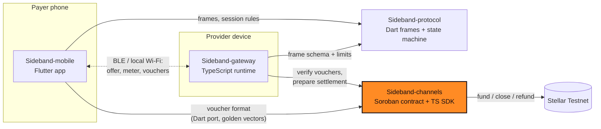

<div align="center">


# Sideband Channels

**Stellar payment channels and cumulative vouchers for offline, metered payments.**

Part of [Sideband](#how-sideband-works): nearby services, metered value, Stellar settlement.

[](https://github.com/Sideband34/Sideband-channels/actions/workflows/ci.yml)
[](./LICENSE)
[](#status)
[](./SECURITY.md)
[](https://github.com/Sideband34/Sideband-gateway/blob/main/gitbook/README.md)
[](https://github.com/Sideband34/Sideband-channels/issues?q=is%3Aissue+is%3Aopen+label%3A%22Stellar+Wave%22)

[Docs](https://github.com/Sideband34/Sideband-gateway/blob/main/gitbook/README.md) · [Live site](https://sideband-web1.vercel.app) · [Quick start](#quick-start) · [Status](#status) · [Architecture](#how-it-fits-together) · [Contributing](#contributing) · [Security](#security)

</div>

> [!WARNING]
> Pre-release software for **Stellar Testnet and synthetic assets only**. The channel contract and
> voucher format are **unaudited**. Do not use with real funds.

## What this is

Sideband-channels is the payment layer. A payer locks funds in a Soroban payment channel contract on Stellar. After that, each metered unit is paid with a small signed promise (a cumulative voucher) that the provider can check without any network. This repository holds the channel contract, the TypeScript SDK that creates and verifies vouchers, and the settlement logic that turns the provider's highest voucher into an on-chain withdrawal.

What is inside:

- **Vouchers** (`src/vouchers`): domain-separated cumulative commitments (ed25519 via
  `@stellar/stellar-sdk`) bound to network, channel, payer and provider, using the upstream
  one-way-channel commitment layout. `acceptVoucher` + `VoucherStore` give atomic
  compare-and-swap acceptance and reject replay, rollback, over-deposit, over-budget, expiry,
  wrong network/channel and tampering, including concurrent races.
- **Channel adapters** (`src/channels`): a `ChannelAdapter` interface with an
  `InMemoryChannelAdapter` (labelled test adapter; every receipt is `synthetic: true`) and a
  `SorobanChannelAdapter` with an RPC client, exercised against a fake chain client. Both
  implement `open`, `topUp`, `settle`, `close`, `closeStart` and `refund`.
- **Settlement intents** (`src/settlement`): `CREATED → AUTHORIZED → SUBMITTED → CONFIRMED`, with
  `RECONCILING` after a post-submit timeout; `CONFIRMED` requires finality evidence for the right
  network.
- **Soroban contract** (`contracts/channel`): `init`, payer `top_up`, provider `settle` (withdraw
  without closing) and `close`, payer `close_start` with a dispute window in which the provider can
  still submit a higher voucher, then `refund` of the remainder. Checked arithmetic, auth on every
  path, terminal single-close, events, and `prepare_commitment` for encoder parity
  ([ADR 0002](docs/adr/0002-channel-lifecycle.md)). Rust tests use the TS golden vectors plus a
  funds-conservation property test.
- **Network policy:** the public network is refused; unknown passphrases fail closed.

## Quick start

Requires Node 22+; the contract needs a stable Rust toolchain.

```bash
git clone https://github.com/Sideband34/Sideband-channels && cd Sideband-channels
npm ci
npm run check                    # prettier, eslint, tsc, 64 vitest tests
npx tsx examples/offline-session.ts
npm run fixtures                 # regenerate fixtures/voucher-vectors.json
cd contracts && cargo test       # 23 contract tests (incl. proptest)
```

### Building the WASM contract

```bash
rustup target add wasm32v1-none
cd contracts
stellar contract build            # recommended (stellar-cli >= 25.2)
# Fallback without stellar-cli (what CI runs):
SOROBAN_SDK_BUILD_SYSTEM_SUPPORTS_SPEC_SHAKING_V2=1 \
  cargo build --release --target wasm32v1-none -p sideband-channel
```

The fallback sets the flag stellar-cli would set; treat the artifact as a build check only.
Upload/deploy to Testnet is not automated or tested yet.

## Status

| Area | Status |
|---|---|
| Voucher format, verification, CAS acceptance | Implemented, tested |
| Settlement intent state machine | Implemented, tested |
| Settlement kinds `settle` (stay open) / `close` (terminal) | Implemented, tested |
| Session baseline in `acceptVoucher` (several sessions per channel) | Implemented, tested |
| In-memory channel adapter (open, top-up, settle, close, close-start, refund) | Implemented (synthetic receipts only) |
| Soroban adapter + RPC client | Implemented, tested against a fake chain client only |
| Soroban contract: top-up, settle, dispute window, refund, events | Implemented; 23 Rust tests incl. a funds-conservation property test; WASM built and uploaded as a CI artifact |
| `scripts/deploy-testnet.sh`, `scripts/smoke-testnet.sh`, `scripts/smoke-refund-testnet.sh` (stellar-cli) | **Run on Testnet on 2026-11-04**; results in [docs/DEPLOYMENT.md](./docs/DEPLOYMENT.md) |
| Testnet deployment / real transaction hashes | **Done (Testnet only)**: see the Deployments section below |
| Security audit | **None** (upstream one-way-channel is also unaudited) |


### Deployments (Stellar Testnet, 2026-11-04)

Public addresses and hashes only. Testnet XLM, synthetic. **Not audited.**

| Item | Value |
|---|---|
| Channel wasm hash | `8912942ed2dcf59a71b189c3eb8377264c04f72476d148a5ed84fd62f1ec71cb` |
| Smoke channel | [`CD67A4SD2ZWA4BPWVCJKSJ3AI4TJCHEJRUJIDUPPOWT4CEQAJOMS5OTS`](https://stellar.expert/explorer/testnet/contract/CD67A4SD2ZWA4BPWVCJKSJ3AI4TJCHEJRUJIDUPPOWT4CEQAJOMS5OTS) (deploy ledger 5557371) |
| Gateway-settled channel | [`CDDKJTRAJW64GEABEPH6BBPMTZSC7Z3ERALFPGWGRGZ26H2DYMN2RLER`](https://stellar.expert/explorer/testnet/contract/CDDKJTRAJW64GEABEPH6BBPMTZSC7Z3ERALFPGWGRGZ26H2DYMN2RLER) |
| Payer / provider | `GC7ZWRDXDPR6OFB6R72463R6PQQJHOEII5EVEEKOSK5ZQDQRYJSHPHRX` / `GBGVFJ3SDXJMUHW7WDZQSV6GXNU6MVY2BMTK2G6QREAZYW7OI64J75MP` |

Every transaction hash and the smoke results are in [docs/DEPLOYMENT.md](./docs/DEPLOYMENT.md). Channels are cheap to create;
these are demo instances, not a service anyone should deposit into.

The voucher bytes follow the upstream one-way-channel commitment layout but have not been checked
against a live upstream contract on Testnet; see
[`docs/adr/0001-voucher-test-format.md`](./docs/adr/0001-voucher-test-format.md).

### Compatibility

| Repository | Contract |
|---|---|
| [Sideband-protocol](https://github.com/Sideband34/Sideband-protocol) v0.1.0 | `VoucherFrame {channelRef, cumulativeAmount, commitment, signature}` with the canonical 7-decimal amount; `commitment` = hex sha256(preimage), `signature` = hex ed25519 |
| [Sideband-gateway](https://github.com/Sideband34/Sideband-gateway) | consumes `acceptVoucher`, `VoucherStore`, `prepareSettlement`, `SorobanChannelAdapter` |
| [Sideband-mobile](https://github.com/Sideband34/Sideband-mobile) | Dart port of the commitment and signing, checked against `fixtures/voucher-vectors.json` |

## How Sideband works

Sideband lets a phone pay a nearby device for a small metered service (for example, text
processing priced per word) over Bluetooth LE or local Wi-Fi, without needing the internet during
the session:

1. **Fund a channel (online).** The payer deposits a Testnet asset into a Soroban payment channel
   bound to one provider.
2. **Discover nearby.** Devices find each other locally, verify the provider's signed service
   manifest, and agree on price, units and a spending cap.
3. **Stream with signed vouchers (offline).** Each metered unit is paid with a cumulative,
   domain-separated voucher signed on the phone. The provider verifies it locally and rejects
   replays and rollbacks.
4. **Settle later (online).** The provider withdraws up to its highest voucher on-chain, either
   keeping the channel open (`settle`) or closing it (`close`, which refunds the rest). A payer
   can start a close at any time; the provider then has a dispute window to submit its highest
   voucher before the payer reclaims the remainder.

A voucher is a commitment against already-locked funds, **not** a completed payment. Nothing is
shown as settled until Stellar confirms it.

## How it fits together

Four repositories, one responsibility each. No payment signing lives in transport code, and no
chain logic lives in the app. This repository is highlighted.



| Repository | Stack | Responsibility |
|---|---|---|
| [Sideband-mobile](https://github.com/Sideband34/Sideband-mobile) | Flutter | Payer app: discovery UX, spend limits, voucher signing, history and receipts |
| [Sideband-protocol](https://github.com/Sideband34/Sideband-protocol) | Dart | Versioned session frames, canonical encoding, session state machine, metering, transport contract |
| [Sideband-gateway](https://github.com/Sideband34/Sideband-gateway) | TypeScript | Provider runtime: signed manifest, metered service, anti-replay voucher validation, settlement prep, landing site |
| [**Sideband-channels**](https://github.com/Sideband34/Sideband-channels) | Rust · TypeScript | Soroban payment channel contract, cumulative voucher format, channel adapters, settlement intents |

Cross-repo contracts are pinned with fixtures: voucher golden vectors from `Sideband-channels`,
and a synthetic session transcript from `Sideband-gateway`. See
[`docs/ARCHITECTURE.md`](./docs/ARCHITECTURE.md) for data and ownership paths.

## Tech stack

| Layer | Technology |
|---|---|
| Contract | Rust 2021, `soroban-sdk` 29.0.1, target `wasm32v1-none`, built with `stellar contract build` |
| SDK | TypeScript 5.9, Node 22 or newer, `@stellar/stellar-sdk` 17 |
| Tests | Vitest 5 (64 tests), Rust unit and property tests (23), golden voucher vectors |
| Tooling | ESLint, Prettier, shellcheck on the scripts, stellar-cli 25.2 or newer for deploy and smoke scripts |

## Project structure

```
contracts/channel/   Soroban channel contract (Rust) and its tests
src/vouchers/        voucher format, signing, verification, compare-and-swap store
src/channels/        ChannelAdapter, in-memory and Soroban adapters
src/settlement/      settlement intents and reconciliation
fixtures/            golden voucher vectors shared with the Dart port
scripts/             deploy, smoke and refund scripts (stellar-cli)
docs/                architecture, threat model, deployment evidence, ADRs
```

## Contributing

Contributions are welcome. Start with [CONTRIBUTING.md](./CONTRIBUTING.md) for the local checks and the workflow, then pick an open issue labelled
[`Stellar Wave`](https://github.com/Sideband34/Sideband-channels/issues?q=is%3Aissue+is%3Aopen+label%3A%22Stellar+Wave%22). Each issue lists context, scope, implementation notes and
acceptance criteria, and carries a `trivial`, `medium` or `high` complexity label. New here? Try [`good first issue`](https://github.com/Sideband34/Sideband-channels/issues?q=is%3Aissue+is%3Aopen+label%3A%22good+first+issue%22).
Please follow the [Code of Conduct](./CODE_OF_CONDUCT.md).

**Drips Wave.** Sideband applies to [Drips Wave](https://docs.drips.network/wave) on Stellar. Acceptance and rewards depend on the organizers and are not guaranteed.

## Security

Report vulnerabilities privately, as described in [SECURITY.md](./SECURITY.md). The threat model and what is not covered are in [docs/SECURITY.md](./docs/SECURITY.md).
This is a Testnet prototype and has not been audited. Never post keys or seeds in an issue, even Testnet ones.

## Community

Questions and ideas: [GitHub Discussions](https://github.com/Sideband34/Sideband-channels/discussions).
<!-- Owner: add the community invite link (Telegram or Discord) on this line when it exists. -->

## Maintainers

| Maintainer | Role | Contact |
|---|---|---|
| [Cjay-Cyber-2](https://github.com/Cjay-Cyber-2) | Maintainer | GitHub [issues](https://github.com/Sideband34/Sideband-channels/issues) and [Discussions](https://github.com/Sideband34/Sideband-channels/discussions) |

## Contributors

<a href="https://github.com/Sideband34/Sideband-channels/graphs/contributors">
  
</a>

## License

[MIT](./LICENSE)
