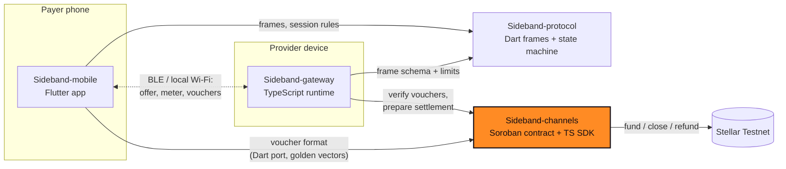

<div align="center">


# Sideband Channels

**Stellar payment channels and cumulative vouchers for offline, metered payments.**

Part of [Sideband](#how-sideband-works): nearby services, metered value, Stellar settlement.

[](https://github.com/Sideband34/Sideband-channels/actions/workflows/ci.yml)
[](./LICENSE)
[](#status)
[](./SECURITY.md)

[How it works](#how-sideband-works) · [Quickstart](#quickstart) · [Status](#status) · [Architecture](#architecture) · [Contributing](#contributing) · [Security](#security)

</div>

> [!WARNING]
> Pre-release software for **Stellar Testnet and synthetic assets only**. The channel contract and
> voucher format are **unaudited**. Do not use with real funds.

## What this repository is

The payment layer of Sideband: a Soroban one-way payment channel contract and a TypeScript SDK
that every other component uses to create, verify and settle vouchers.

- **Vouchers** (`src/vouchers`): domain-separated cumulative commitments (ed25519 via
  `@stellar/stellar-sdk`) bound to network, channel, payer and provider, using the upstream
  one-way-channel commitment layout. `acceptVoucher` + `VoucherStore` give atomic
  compare-and-swap acceptance and reject replay, rollback, over-deposit, over-budget, expiry,
  wrong network/channel and tampering, including concurrent races.
- **Channel adapters** (`src/channels`): a `ChannelAdapter` interface with an
  `InMemoryChannelAdapter` (labelled test adapter; every receipt is `synthetic: true`) and a
  `SorobanChannelAdapter` with an RPC client, exercised against a fake chain client. Both
  implement `open`, `topUp`, `settle`, `close`, `closeStart` and `refund`.
- **Settlement intents** (`src/settlement`): `CREATED → AUTHORIZED → SUBMITTED → CONFIRMED`, with
  `RECONCILING` after a post-submit timeout; `CONFIRMED` requires finality evidence for the right
  network.
- **Soroban contract** (`contracts/channel`): `init`, payer `top_up`, provider `settle` (withdraw
  without closing) and `close`, payer `close_start` with a dispute window in which the provider can
  still submit a higher voucher, then `refund` of the remainder. Checked arithmetic, auth on every
  path, terminal single-close, events, and `prepare_commitment` for encoder parity
  ([ADR 0002](docs/adr/0002-channel-lifecycle.md)). Rust tests use the TS golden vectors plus a
  funds-conservation property test.
- **Network policy:** the public network is refused; unknown passphrases fail closed.

## Quickstart

Requires Node 22+; the contract needs a stable Rust toolchain.

```bash
git clone https://github.com/Sideband34/Sideband-channels && cd Sideband-channels
npm ci
npm run check                    # prettier, eslint, tsc, 50 vitest tests
npx tsx examples/offline-session.ts
npm run fixtures                 # regenerate fixtures/voucher-vectors.json
cd contracts && cargo test       # 9 contract tests
```

### Building the WASM contract

```bash
rustup target add wasm32v1-none
cd contracts
stellar contract build            # recommended (stellar-cli >= 25.2)
# Fallback without stellar-cli (what CI runs):
SOROBAN_SDK_BUILD_SYSTEM_SUPPORTS_SPEC_SHAKING_V2=1 \
  cargo build --release --target wasm32v1-none -p sideband-channel
```

The fallback sets the flag stellar-cli would set; treat the artifact as a build check only.
Upload/deploy to Testnet is not automated or tested yet.

## Status

| Area | Status |
|---|---|
| Voucher format, verification, CAS acceptance | Implemented, tested |
| Settlement intent state machine | Implemented, tested |
| In-memory channel adapter | Implemented (synthetic receipts only) |
| Soroban adapter + RPC client | Implemented, tested against a fake chain client only |
| Soroban contract | Implemented, tested in the SDK environment; WASM builds in CI |
| Testnet deployment / real transaction hashes | **Not done** |
| Security audit | **None** (upstream one-way-channel is also unaudited) |

The voucher bytes follow the upstream one-way-channel commitment layout but have not been checked
against a live upstream contract on Testnet; see
[`docs/adr/0001-voucher-test-format.md`](./docs/adr/0001-voucher-test-format.md).

### Compatibility

| Repository | Contract |
|---|---|
| [Sideband-protocol](https://github.com/Sideband34/Sideband-protocol) v0.1.0 | `VoucherFrame {channelRef, cumulativeAmount, commitment, signature}` with the canonical 7-decimal amount; `commitment` = hex sha256(preimage), `signature` = hex ed25519 |
| [Sideband-gateway](https://github.com/Sideband34/Sideband-gateway) | consumes `acceptVoucher`, `VoucherStore`, `prepareSettlement`, `SorobanChannelAdapter` |
| [Sideband-mobile](https://github.com/Sideband34/Sideband-mobile) | Dart port of the commitment and signing, checked against `fixtures/voucher-vectors.json` |

## How Sideband works

Sideband lets a phone pay a nearby device for a small metered service (for example, text
processing priced per word) over Bluetooth LE or local Wi-Fi, without needing the internet during
the session:

1. **Fund a channel (online).** The payer deposits a Testnet asset into a Soroban payment channel
   bound to one provider.
2. **Discover nearby.** Devices find each other locally, verify the provider's signed service
   manifest, and agree on price, units and a spending cap.
3. **Stream with signed vouchers (offline).** Each metered unit is paid with a cumulative,
   domain-separated voucher signed on the phone. The provider verifies it locally and rejects
   replays and rollbacks.
4. **Settle later (online).** The provider withdraws up to its highest voucher on-chain, either
   keeping the channel open (`settle`) or closing it (`close`, which refunds the rest). A payer
   can start a close at any time; the provider then has a dispute window to submit its highest
   voucher before the payer reclaims the remainder.

A voucher is a commitment against already-locked funds, **not** a completed payment. Nothing is
shown as settled until Stellar confirms it.

## Architecture

Four repositories, one responsibility each. No payment signing lives in transport code, and no
chain logic lives in the app. This repository is highlighted.



| Repository | Stack | Responsibility |
|---|---|---|
| [Sideband-mobile](https://github.com/Sideband34/Sideband-mobile) | Flutter | Payer app: discovery UX, spend limits, voucher signing, history and receipts |
| [Sideband-protocol](https://github.com/Sideband34/Sideband-protocol) | Dart | Versioned session frames, canonical encoding, session state machine, metering, transport contract |
| [Sideband-gateway](https://github.com/Sideband34/Sideband-gateway) | TypeScript | Provider runtime: signed manifest, metered service, anti-replay voucher validation, settlement prep, landing site |
| [**Sideband-channels**](https://github.com/Sideband34/Sideband-channels) | Rust · TypeScript | Soroban payment channel contract, cumulative voucher format, channel adapters, settlement intents |

Cross-repo contracts are pinned with fixtures: voucher golden vectors from `Sideband-channels`,
and a synthetic session transcript from `Sideband-gateway`. See
[`docs/ARCHITECTURE.md`](./docs/ARCHITECTURE.md) for data and ownership paths.

## Contributing

Contributions are welcome. Start with [CONTRIBUTING.md](./CONTRIBUTING.md) for the local checks and
workflow, and pick from the scoped work in
[docs/CONTRIBUTOR_ISSUES.md](./docs/CONTRIBUTOR_ISSUES.md): each item lists its interfaces,
acceptance tests and size. Please follow the [Code of Conduct](./CODE_OF_CONDUCT.md).

**Drips Wave.** Sideband intends to participate in
[Drips Wave](https://docs.drips.network/wave/maintainers/participating-in-a-wave/) on Stellar.
Participation and rewards depend on organizer approval and are not guaranteed. Wave issues are
real, scoped work in this repository's boundary, never filler.

## Security

Please report vulnerabilities privately; see [SECURITY.md](./SECURITY.md). The threat model is
in [docs/SECURITY.md](./docs/SECURITY.md). Never post keys or seeds in issues, even Testnet ones.

## Project documents

[PRD](./docs/PRD.md) · [Requirements](./docs/SRD.md) · [Architecture](./docs/ARCHITECTURE.md) ·
[Stellar protocol](./docs/STELLAR_PROTOCOL.md) · [Roadmap](./docs/ROADMAP.md) ·
[Brand](./docs/BRAND.md) · [Agent rules](./AGENTS.md)

The approved logo is in [`brand/`](./brand) and shared by all four repositories.

## License

[MIT](./LICENSE)
